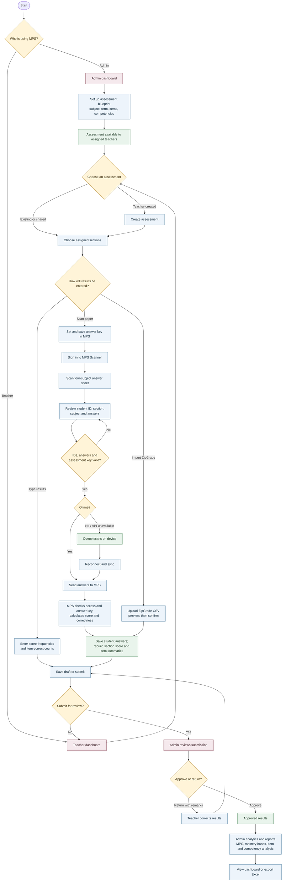

# MPS System Flow

This chart shows how assessments move through MPS, from setup and student results to review and school analytics. It includes the three ways results enter the system: teacher encoding, the MPS Scanner, and ZipGrade CSV.

## How to read it

- **Assessment setup:** Admins can publish a shared blueprint; teachers may also create an assessment where that workflow is available.
- **Results entry:** Teachers can encode summaries directly, import a ZipGrade CSV, or scan individual answer sheets. Scanner and ZipGrade data cannot both be used for the same assessment section at once.
- **Scanner path:** The device reads and lets the teacher correct the sheet. Online scans go to MPS; offline scans wait in an on-device queue until sync. MPS calculates each student's score from the saved answer key and updates the same summaries used by the other entry paths.
- **Review and reporting:** Teachers submit results. Admins approve them or return them with remarks. Approved data is used in admin analytics and exports.

The scanner also supports an older generic document-reading screen; that path is a local preview/mock workflow and is not part of assessment submission.
